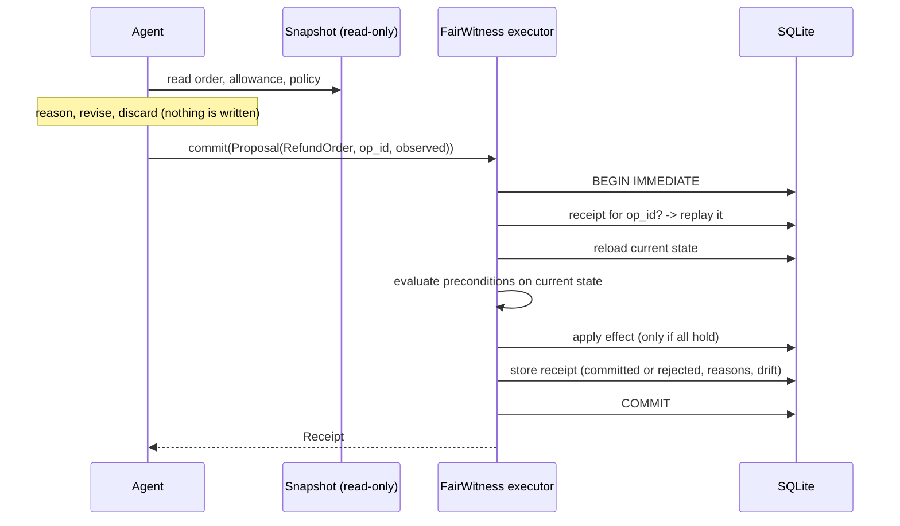

# fairwitness-db

**Commit-time checks for database changes proposed by AI agents and applications.**

Define an operation and its business rules in Python. FairWitness checks current database state, applies allowed changes, and saves a decision receipt in one transaction. Retrying the same operation ID returns the saved decision without repeating the change.

Use it where an agent, background job or application requests a database change. Refunds are the demonstration below; the same executor also runs the included inventory-reservation example. Developers define the supported operations and checks.

  

Version 0.1.0 is an alpha SQLite implementation. The demos use a deterministic Python agent; real LLM integration, MCP, PostgreSQL and external payment execution are planned.

## The database committed the wrong refund

An agent reads an order. It is eligible for a refund. While the agent is reasoning, a payments webhook opens a dispute, which makes the order ineligible. The agent resumes and writes the refund.

```text
$ fairwitness demo
  baseline (agent writes in its own txn)       COMMITTED $80.00               WRONG: refund issued on a disputed order
  snapshot review (2nd check, same context)    COMMITTED $80.00               WRONG: refund issued on a disputed order
  plain transaction (hand-written recheck)     REJECTED  order_disputed       ok
  fairwitness-db                               REJECTED  order_disputed       ok
  fairwitness-db, strict mode                  REJECTED  stale_evidence       ok

  fairwitness-db receipt (stored in the same transaction as the decision):
    drift   orders/1001.disputed_seq: None -> 1
    drift   orders/1001.status: 'paid' -> 'disputed'
    check   invalid_amount         pass  (amount must be positive)
    check   order_not_found        pass  (order must exist)
    check   order_disputed         FAIL  (no refunds while a dispute is open)
```

The baseline's write is a correct, serialized SQL transaction. Isolation did its job. The problem is that the agent's *reason* for the write came from a read outside that transaction.

**Two worlds, one context.** Take two worlds that differ only in whether the dispute opened during the pause. The agent's context is identical in both. Anything that decides from that context alone, including a second model reviewing it, must act the same in both worlds, so it is wrong in one of them. Only a fresh, authoritative check at the moment of commitment can tell the worlds apart.

## Quickstart

Distribution: `fairwitness-db`. Python import: `fairwitness`. Command: `fairwitness`. Install from a checkout using the steps below; PyPI publication is a separate release step.

```bash
# From the project directory, using Python 3.10 or newer:
python3 -m venv .venv
source .venv/bin/activate
python -m pip install -e '.[dev]'
fairwitness demo              # five deterministic scenes, ~1 second
fairwitness chaos --runs 200  # seeded randomized interleavings, about half a minute
```

With the virtual environment active: `make test && make lint && make demo`. Use `make build` to produce a wheel and source distribution. Python 3.10+, zero runtime dependencies (stdlib `sqlite3`); pytest, Ruff and build are development tools.

## Results

`fairwitness chaos --runs 200 --seed 0`. Each run: 12 orders, 30 agents, 5 disputes and 1 policy change, interleaved at random. The same plan is replayed against every strategy.

| strategy | committed | rejected | runs with violations | invariant violations |
| --- | ---: | ---: | ---: | ---: |
| baseline | 3,048 | 0 | 200 / 200 | 2,222 |
| snapshot review | 3,048 | 0 | 200 / 200 | 2,222 |
| plain transaction | 1,788 | 2,063 | 0 / 200 | 0 |
| **fairwitness-db** | **1,788** | **2,063** | **0 / 200** | **0** |
| fairwitness-db, strict | 1,078 | 3,247 | 0 / 200 | 0 |

Full output: [`docs/results/chaos-200-seed0.txt`](docs/results/chaos-200-seed0.txt). Violations are counted from the database alone: refunds issued after a dispute, orders refunded beyond their amount, an overspent shared allowance, refunds above the policy cap in force, and ledger mismatches.

Three findings:

1. **A second opinion over stale context changes nothing.** Snapshot review made exactly the baseline's decisions.
2. **fairwitness-db makes exactly the decisions a correct hand-written transaction makes:** same commits, same rejection reasons. It does not need magic to be right. It makes the right check reusable, idempotent and auditable.
3. **Strict mode committed about 40% fewer refunds in this simulation, with zero violations of encoded rules in either mode.** It also rejects changes to recorded facts that no rule mentions. This result describes this workload, not a general performance guarantee.

## How it works



1. **Speculate.** The agent reads a consistent snapshot and builds a typed proposal. It can revise or discard it freely.
2. **Commit.** The executor reloads the state the operation depends on, re-evaluates its preconditions, applies the change and stores a receipt, all in one transaction. If the evidence changed, the agent gets a specific reason it can act on, such as `order_disputed`.
3. **Retry.** If the response is lost after the commit, repeating the same `op_id` returns the stored receipt. The same `op_id` with different arguments raises `IdempotencyConflict`.

## Define an operation

```python
from dataclasses import dataclass
from typing import ClassVar
from fairwitness import FairWitness, Operation, Precondition

@dataclass(frozen=True)
class ReserveStock(Operation):
    kind: ClassVar[str] = "reserve_stock"
    sku: str
    qty: int

    def load(self, tx):                       # runs inside the commit transaction
        return tx.get("items", self.sku)

    def preconditions(self, item):            # evaluated in order, on CURRENT state
        yield Precondition("invalid_quantity", lambda: self.qty > 0)
        yield Precondition("unknown_sku", lambda: item is not None)
        yield Precondition("item_recalled", lambda: not item["recalled"])
        yield Precondition("insufficient_stock",
                           lambda: item["on_hand"] - item["reserved"] >= self.qty)

    def apply(self, tx, item):
        tx.update("items", self.sku, {"reserved": item["reserved"] + self.qty})
        return {"reserved": self.qty}

r = FairWitness("shop.db", key_columns={"items": "sku"})
with r.snapshot() as snap:                     # the agent's view
    snap.read("items", "kettle")
    proposal = snap.propose(ReserveStock("kettle", 2), op_id="cart-55:reserve")
receipt = r.commit(proposal)                   # committed, or rejected with a reason
```

Full runnable version: [`examples/inventory_reservation.py`](examples/inventory_reservation.py).

## What is guaranteed, and what is not

**Guaranteed** for writes that go through the executor:

- The effect and its receipt commit together or not at all (tested by raising exceptions at four commit stages).
- Every encoded precondition held in the state the effect was applied to. Commits are serialized with `BEGIN IMMEDIATE`.
- One `op_id` produces at most one decision. Retries replay it; conflicting reuse is refused.
- Each receipt lists the field-level drift between what the agent saw and what was true at commit.

**Not guaranteed:**

- Rules you did not encode. Default mode re-checks only the stated preconditions. Strict mode compares the recorded rows' current contents, excluding the `version` column. It cannot detect unrecorded dependencies or a value that changed and then returned to its observed value.
- Untrusted operation implementations. Operations are application code: keep `load` and preconditions read-only, put database changes in `apply`, and keep external calls outside the commit transaction. Type hints do not validate incoming arguments.
- Writes that bypass the executor.
- External side effects. A real payment provider is a separate failure boundary that needs an outbox and reconciliation (see the roadmap).
- Multi-node deployments. v1 is single-node SQLite.

Details in [`docs/design.md`](docs/design.md).

## Prior art

This is not a new idea, and the repo does not claim one. *When AI Agents Commit* (He & Yu, 2026) formalizes commit-time recertification of an agent's effect against current dependencies and policy, with receipts committed alongside the effect. *Agentic Transaction* (Sun, Wang & Li, 2026) adapts ACID to agent execution. fairwitness-db is a small, dependency-free implementation that makes the failure and the fix easy to reproduce, measure and test. See [`docs/related-work.md`](docs/related-work.md).

## Roadmap

- **v0.2** – MCP server so any agent can call `propose` / `commit` as tools; a real LLM in the demo loop.
- **v0.3** – PostgreSQL backend under `SERIALIZABLE`, with predicate preconditions (`no open dispute for this customer`).
- **v0.4** – External effects: transactional outbox, provider idempotency keys, reconciliation against a mock payment provider.
- **v0.5** – Policy and authority: versioned policies, human approval thresholds, and per-agent permissions.

See [`docs/roadmap.md`](docs/roadmap.md). Suggested starter tasks are listed in [`CONTRIBUTING.md`](CONTRIBUTING.md).

## License

MIT
